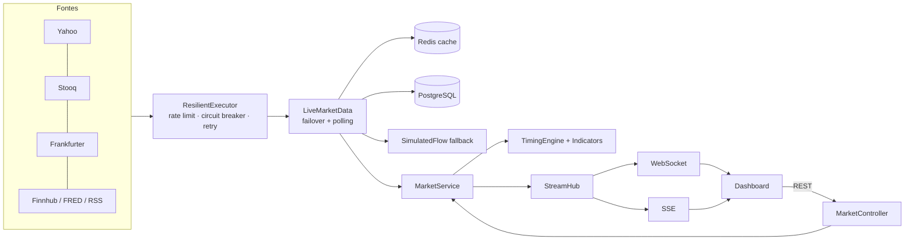

# MeridianWealth

Plataforma analítica em Java 21 que mostra, em tempo real, **quando comprar na baixa, quando manter a tendência e quando realizar lucro na alta**, com cada sinal explicado por fórmulas e gatilhos. Não executa ordens.

> **Aviso legal:** ferramenta de análise quantitativa e educacional. Não constitui recomendação financeira regulada e não executa ordens.

## O que o sistema faz

- **Dados reais gratuitos com failover:** Yahoo Finance, Stooq, Frankfurter (BCE), Finnhub (com chave), FRED (com chave) e feeds RSS. Cada provedor tem rate limiter, circuit breaker, retry com backoff exponencial e jitter, e cache (Redis ou memória). Se tudo falhar, cai no banco de dados e, por último, no simulador.
- **Polling inteligente:** a cada 30 s com pregão aberto e a cada 10 min com pregão fechado (EUA, Europa, câmbio e commodities), com cotações compartilhadas via cache.
- **Fluxo simulado opcional:** entre cotações atrasadas, um micro-fluxo sobre a última cotação real mantém o painel vivo. Um botão no topo liga e desliga; o modo (REAL, MISTO, SIMULADO) fica sempre visível.
- **Motor quantitativo e de timing explicável:** Z-Score, percentil, RSI, MACD, Bollinger, ATR, volatilidade, drawdown, Sharpe, VaR, força relativa, volume relativo, risco/retorno, expectativa e Kelly fracionado.
- **Camada macro, micro e geopolítica:** VIX, dólar, juros, manchetes pontuadas por palavras-chave com impacto por setor, e fundamentos (Finnhub).
- **Tempo real:** WebSocket com fallback automático para SSE.
- **Persistência:** PostgreSQL com Flyway (candles e histórico de sinais) e Redis (cotações, backtests, rate limit da API).
- **Qualidade:** testes JUnit 5 (unitários e de integração), Checkstyle, Spotless, GitHub Actions, OpenAPI/Swagger.

## Executar

```bash
cp .env.example .env              # opcional: FINNHUB_API_KEY e FRED_API_KEY
docker compose up --build         # app + PostgreSQL + Redis em http://localhost:8080

# sem Docker (Java 21 + Maven): sem Postgres/Redis, cache em memória
mvn verify
mvn spring-boot:run
MW_DATA_MODE=simulated mvn spring-boot:run     # modo offline
```

Swagger: `http://localhost:8080/swagger-ui.html`. Saúde: `/actuator/health`.

## Variáveis de ambiente

| Variável | Padrão | Uso |
|---|---|---|
| `MW_DATA_MODE` | `auto` | `auto` = provedores reais com fallback; `simulated` = só simulador |
| `FINNHUB_API_KEY` | vazio | cotações Finnhub, fundamentos e notícias |
| `FRED_API_KEY` | vazio | juros de 10 anos via FRED (senão usa Yahoo `^TNX`) |
| `MW_CACHE_TYPE` | `memory` | `redis` no Compose |
| `MW_PERSISTENCE` | `false` | `true` grava candles e sinais no PostgreSQL |
| `MW_EXCLUDE_AUTOCONFIG` | lista JDBC/Flyway/Redis | vazio no Compose para ligar banco e Redis |
| `DB_URL`, `DB_USER`, `DB_PASSWORD`, `REDIS_HOST`, `REDIS_PORT` | locais | conexões |

## Endpoints

`GET /api/universe`, `/api/overview`, `/api/candles/{symbol}`, `/api/assessment/{symbol}`, `/api/micro/{symbol}`, `/api/signals/{symbol}`, `/api/backtest/{symbol}?buyScore=35&sellScore=30&bars=600`, `/api/status`, `POST /api/settings/flow?enabled=true|false`, `/api/stream` (SSE), `/ws/stream` (WebSocket).

## Arquitetura



Pacotes: `domain` (cálculos e regras, sem framework), `application` (casos de uso e portas), `infrastructure` (provedores, resiliência, cache, persistência, stream), `web` (REST e OpenAPI). Detalhes em `docs/architecture.md` e `docs/quant-models.md`.

## Limites reais das fontes gratuitas

- **Atraso:** Yahoo e Stooq entregam cotações com atraso (em geral 15 min ou mais) e podem mudar o formato ou bloquear sem aviso. O Stooq pode exigir chave ou captcha no download CSV.
- **Cobertura:** o plano gratuito do Finnhub cobre ações dos EUA e limita a 60 requisições por minuto. Fundamentos só existem para esses ativos.
- **Frankfurter** traz só a taxa diária do BCE, sem OHLC nem volume.
- **Barras diárias:** o motor trabalha com barras diárias. A última barra é atualizada ao vivo; uma nova barra nasce quando a cotação muda de dia.
- **Notícias:** o risco geopolítico usa palavras-chave em inglês. É um indicador grosseiro, não leitura de contexto.
- **Backtest:** estima como as regras se comportariam no histórico carregado; não prova retorno futuro.
