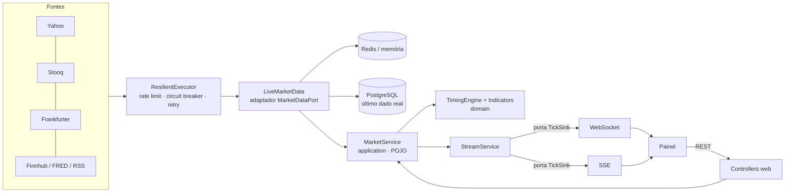

# MeridianWealth

[](https://github.com/VFSVINI/meridian-wealth/actions/workflows/ci.yml)
[](https://github.com/VFSVINI/meridian-wealth/actions/workflows/codeql.yml)

**Plataforma institucional multi-ativo de gestão de patrimônio, inteligência quantitativa e geolocalização de ativos reais**, em Java 21 e Spring Boot 3. Hoje entrega um cockpit analítico que mostra **quando comprar na baixa, quando manter a tendência e quando realizar lucro na alta**, com cada sinal explicado por fórmulas e gatilhos.

> **Aviso legal:** ferramenta analítica e educacional. Não executa ordens reais e não constitui recomendação financeira.

> **Dados 100% reais:** nenhum preço é simulado, interpolado ou animado. Cada cotação mostra **fonte, horário e atraso**; sem provedor disponível, a tela diz "sem dado em tempo real" e, se existir, mostra o último dado real gravado com data e hora ([ADR 004](docs/adr/004-dados-reais-e-procedencia.md)). Roadmap, regras e dívidas técnicas em [`docs/PROJETO.md`](docs/PROJETO.md).

## O que o sistema faz

- **Dados reais gratuitos com failover:** Yahoo Finance, Stooq, Frankfurter (BCE), Finnhub (com chave), FRED (com chave) e feeds RSS. Cada provedor tem rate limiter, circuit breaker, retry com backoff exponencial e jitter, e cache (Redis ou memória). Se tudo falhar, usa o último dado real gravado no banco (rotulado) e, sem ele, mostra o ativo como sem dado e tenta de novo a cada 2 minutos.
- **Polling inteligente:** a cada 30 s com pregão aberto e a cada 10 min com pregão fechado (EUA, Europa, câmbio e commodities), com cotações compartilhadas via cache.
- **Procedência em cada cotação:** selo de atraso (tempo real, ~15 min, fechamento, último dado real gravado), horário da cotação na origem, contagem até a próxima atualização e aviso de cotação desatualizada. O pulso visual só aparece quando chega uma cotação nova.
- **Motor quantitativo e de timing explicável:** Z-Score, percentil, RSI, MACD, Bollinger, ATR, volatilidade, drawdown, Sharpe, VaR, força relativa, volume relativo, risco/retorno, expectativa e Kelly fracionado.
- **Camada macro, micro e geopolítica:** VIX, dólar, juros, manchetes pontuadas por palavras-chave com impacto por setor, e fundamentos (Finnhub).
- **Tempo real:** WebSocket com fallback automático para SSE.
- **Persistência:** PostgreSQL com Flyway (candles e histórico de sinais) e Redis (cotações, backtests, rate limit da API).
- **Qualidade:** testes JUnit 5 (unitários e de integração), Checkstyle, Spotless, GitHub Actions, OpenAPI/Swagger.

## Executar

Só é preciso Java 21: o Maven Wrapper baixa o Maven 3.9.9 (com checksum verificado).

```bash
cp .env.example .env              # opcional: FINNHUB_API_KEY e FRED_API_KEY
docker compose up --build         # app + PostgreSQL + Redis em http://localhost:8080

# sem Docker: sem Postgres/Redis, cache em memória
./mvnw verify                     # testes, cobertura JaCoCo, Checkstyle e Spotless
./mvnw spring-boot:run
```

No PowerShell, use `.\mvnw.cmd` no lugar de `./mvnw`.

Swagger: `http://localhost:8080/swagger-ui.html`. Saúde: `/actuator/health`.

## Variáveis de ambiente

| Variável | Padrão | Uso |
|---|---|---|
| `FINNHUB_API_KEY` | vazio | cotações Finnhub, fundamentos e notícias |
| `FRED_API_KEY` | vazio | juros de 10 anos via FRED (senão usa Yahoo `^TNX`) |
| `MW_CACHE_TYPE` | `memory` | `redis` no Compose |
| `MW_PERSISTENCE` | `false` | `true` grava candles e sinais no PostgreSQL |
| `MW_EXCLUDE_AUTOCONFIG` | lista JDBC/Flyway/Redis | vazio no Compose para ligar banco e Redis |
| `DB_URL`, `DB_USER`, `DB_PASSWORD`, `REDIS_HOST`, `REDIS_PORT` | locais | conexões |

## Endpoints

`GET /api/universe`, `/api/overview`, `/api/candles/{symbol}`, `/api/assessment/{symbol}`, `/api/micro/{symbol}`, `/api/signals/{symbol}`, `/api/backtest/{symbol}?buyScore=35&sellScore=30&bars=600`, `/api/status`, `/api/stream` (SSE), `/ws/stream` (WebSocket).

Ativo sem dado real responde **503** com `{"error": "Sem dado em tempo real para ...", "status": "UNAVAILABLE"}`. Cada item de `/api/overview` traz `status`, `source`, `quoteTime`, `freshness`, `nextUpdateAt` e `marketOpen`.

## Arquitetura



Hexagonal estrita ([ADR 001](docs/adr/001-arquitetura-hexagonal.md)), verificada por ArchUnit no `mvn verify`: `domain` (cálculos e regras, só JDK), `application` (casos de uso POJO e portas, sem Spring/Jackson), `infrastructure` (adaptadores de provedores, resiliência, cache, persistência e WebSocket), `web` (REST, SSE e OpenAPI) e `config` (composição na borda). Detalhes em `docs/architecture.md`, `docs/quant-models.md` e nos ADRs em `docs/adr/`.

## Limites reais das fontes gratuitas

Comportamento observado em 2026-11-20 (sexta-feira, após o fechamento), rodando o app contra as APIs reais:

| Fonte | Ativos | Atraso | Observado |
|---|---|---|---|
| Yahoo (chart v8) | ações, ETFs, índices, câmbio, futuros | ~15 min (fechamento fora do pregão) | respondeu para SPY, AAPL, MSFT, NVDA, STOXX50 e EUR/USD; `regularMarketTime` usado como horário da cotação |
| Frankfurter (BCE) | EUR/USD, GBP/USD | referência diária | respondeu com 500 barras |
| Stooq (CSV) | ações, índices, câmbio | atrasado / diário | **exigiu chave** no download CSV (resposta "sem dados ou exige chave") |
| Finnhub | ações dos EUA | tempo real segundo a documentação pública | não testado (sem chave); validação no PR #3 |
| FRED | juros de 10 anos | diário | não testado (sem chave) |

- **Atraso:** Yahoo e Stooq entregam cotações com atraso (em geral 15 min ou mais) e podem mudar o formato ou bloquear sem aviso. Tempo real verdadeiro de B3 e bolsas europeias exige feed pago (adapter plugável previsto no PR #3).
- **Cobertura:** o plano gratuito do Finnhub cobre ações dos EUA e limita a 60 requisições por minuto. Fundamentos só existem para esses ativos.
- **Frankfurter** traz só a taxa diária do BCE, sem OHLC nem volume.
- **Barras diárias:** o motor trabalha com barras diárias. A última barra é atualizada ao vivo; uma nova barra nasce quando a cotação muda de dia.
- **Notícias:** o risco geopolítico usa palavras-chave em inglês. É um indicador grosseiro, não leitura de contexto.
- **Backtest:** é uma **projeção** sobre o histórico real carregado; não prova retorno futuro e nunca é exibido como cotação.

## Documentação do projeto

- [`docs/PROJETO.md`](docs/PROJETO.md): visão, regras, roadmap, decisões, dívidas e como rodar.
- [`docs/adr/`](docs/adr/): decisões de arquitetura (hexagonal, precisão financeira, frontend sem build, dados reais e procedência).
- [`CONTRIBUTING.md`](CONTRIBUTING.md), [`SECURITY.md`](SECURITY.md) e [`CHANGELOG.md`](CHANGELOG.md).
