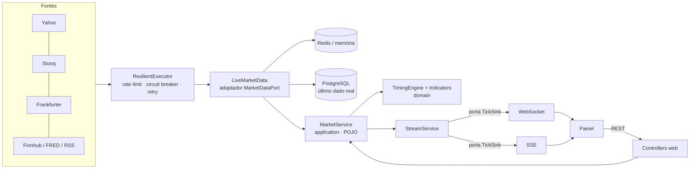

# MeridianWealth

[](https://github.com/VFSVINI/meridian-wealth/actions/workflows/ci.yml)
[](https://github.com/VFSVINI/meridian-wealth/actions/workflows/codeql.yml)

**Plataforma institucional multi-ativo de gestão de patrimônio, inteligência quantitativa e geolocalização de ativos reais**, em Java 21 e Spring Boot 3. Hoje entrega um cockpit analítico que mostra **quando comprar na baixa, quando manter a tendência e quando realizar lucro na alta**, com cada sinal explicado por fórmulas e gatilhos.

> **Aviso legal:** ferramenta analítica e educacional. Não executa ordens reais e não constitui recomendação financeira.

> **Dados 100% reais:** nenhum preço é simulado, interpolado ou animado. Cada cotação mostra **fonte, horário e atraso**; sem provedor disponível, a tela diz "sem dado em tempo real" e, se existir, mostra o último dado real gravado com data e hora ([ADR 004](docs/adr/004-dados-reais-e-procedencia.md)). Roadmap, regras e dívidas técnicas em [`docs/PROJETO.md`](docs/PROJETO.md).

## O que o sistema faz

- **Taxonomia multi-ativo:** 22 tipos (ação, ETF, FII, fundos, os cinco títulos do Tesouro Direto, LCI, LCA, CRI, CRA, notas comerciais e promissórias, cripto, câmbio, commodity e índice) com atributos verificados em fonte pública, como a proteção do FGC. Detalhes e o que **não** foi verificado em [`docs/taxonomia.md`](docs/taxonomia.md).
- **Juros e inflação do Brasil:** Meta Selic, CDI, IPCA e PTAX do Banco Central, exibidos como publicados (texto exato, data de referência, selo de desatualizado), com séries e contratos confirmados contra a API real ([ADR 006](docs/adr/006-taxonomia-e-dados-oficiais-do-bcb.md)).
- **Cripto 24/7:** BTC, ETH, SOL e XRP com preço por WebSocket (Binance, com failover automático para Coinbase e Kraken se houver bloqueio regional HTTP 451), volatilidade anualizada por √365 e beta contra o BTC. Bolsa em uso e motivo de cada isolamento aparecem no status ([ADR 005](docs/adr/005-stream-cripto-com-failover.md)).
- **Bolsas globais:** 33 ativos (29 de bolsas, incluindo 4 FIIs, e 4 cripto) de EUA, Brasil (B3), Europa, Ásia, Oceania, Oriente Médio/África e mercado global, com calendário de pregão por bolsa (fuso, sessões, feriados oficiais conferidos para NYSE, B3 e Xetra). Detalhes em [`docs/mercados.md`](docs/mercados.md).
- **Dados reais gratuitos com failover:** Yahoo Finance, brapi.dev (B3), Frankfurter (BCE), Finnhub REST e WebSocket (com chave), FRED (com chave) e feeds RSS; Stooq desligado (passou a exigir verificação JavaScript); adapter plugável para feed pago, desligado. Cada provedor tem rate limiter, circuit breaker, retry com backoff exponencial e jitter, e cache (Redis ou memória). Se tudo falhar, usa o último dado real gravado no banco (rotulado) e, sem ele, mostra o ativo como sem dado e tenta de novo a cada 2 minutos.
- **Polling inteligente:** a cada 30 s com pregão aberto e a cada 10 min com pregão fechado (EUA, Europa, câmbio e commodities), com cotações compartilhadas via cache.
- **Procedência em cada cotação:** selo de atraso (tempo real, ~15 min, fechamento, último dado real gravado), horário da cotação na origem, contagem até a próxima atualização e aviso de cotação desatualizada. O pulso visual só aparece quando chega uma cotação nova.
- **Motor quantitativo e de timing explicável:** Z-Score, percentil, RSI, MACD, Bollinger, ATR, volatilidade, drawdown, Sharpe, VaR, força relativa, volume relativo, risco/retorno, expectativa e Kelly fracionado.
- **Camada macro, micro e geopolítica:** VIX, dólar, juros, manchetes pontuadas por palavras-chave com impacto por setor, e fundamentos (Finnhub).
- **Tempo real:** WebSocket com fallback automático para SSE.
- **Raio-X de composição:** imóveis (área, vacância, setores dos inquilinos), alocação e localização de fundos imobiliários reais, com fonte, data e "não informado" quando a fonte cala; links para Satélite e Street View ([docs/composicao.md](docs/composicao.md), [ADR 007](docs/adr/007-composicao-curada-e-geolocalizacao.md)).
- **Radar de relatórios:** prazos de divulgação pela regra da CVM e veredito POSITIVO, NEUTRO ou NEGATIVO de cada relatório entregue, sempre com os números e a regra ([docs/relatorios.md](docs/relatorios.md), [ADR 008](docs/adr/008-radar-de-relatorios-e-veredito-mecanico.md)).
- **Suitability e carteira modelo:** questionário de perfil (inspirado nas dimensões da Resolução CVM 30), carteira modelo por perfil e aderência da sua carteira, sem gravar suas respostas ([docs/suitability.md](docs/suitability.md), [ADR 009](docs/adr/009-suitability-por-questionario-e-tetos.md)).
- **Simulador pré-ordem e glossário:** efeito de uma compra ou venda hipotética na concentração, no risco e na aderência (sem cotação e sem enviar ordem), e um glossário que explica cada métrica do painel ([docs/simulador-e-glossario.md](docs/simulador-e-glossario.md), [ADR 010](docs/adr/010-impacto-pre-ordem-e-glossario.md)).
- **Tradutor geopolítico e teses genéricas:** cruza a pressão das manchetes reais por setor com o peso do setor na carteira e lê a carteira por cinco lentes ilustrativas, sem atribuir posições a nenhuma gestora ([docs/teses.md](docs/teses.md), [ADR 011](docs/adr/011-tradutor-geopolitico-e-teses-genericas.md)).
- **Protótipo visual:** a interface segue o protótipo aprovado ([docs/design-prototipo.md](docs/design-prototipo.md), [ADR 012](docs/adr/012-prototipo-visual-como-referencia.md)); a adoção ocorre nos itens #15 a #17.
- **Segurança e login:** JWT de 15 minutos com refresh token rotativo e detecção de reuso, senha com BCrypt, **Login com Google** (ID token validado no servidor, desligado sem `MW_GOOGLE_CLIENT_ID`), modo demonstração, rate limit por usuário e por IP real (`X-Forwarded-For` só de proxy confiável), CORS e CSP restritivos ([docs/seguranca.md](docs/seguranca.md), [ADR 013](docs/adr/013-autenticacao-jwt-google-e-defesas-de-borda.md)). Contas e sessões ficam em memória até o item #12.
- **Persistência:** PostgreSQL com Flyway (candles e histórico de sinais) e Redis (cotações, backtests, rate limit da API).
- **Qualidade:** testes JUnit 5 (unitários e de integração), Checkstyle, Spotless, GitHub Actions, OpenAPI/Swagger.

## Executar

Só é preciso Java 21: o Maven Wrapper baixa o Maven 3.9.9 (com checksum verificado).

```bash
cp .env.example .env              # opcional: FINNHUB_API_KEY e FRED_API_KEY
docker compose up --build         # app + PostgreSQL + Redis em http://localhost:8080

# sem Docker: sem Postgres/Redis, cache em memória
./mvnw verify                     # testes, cobertura JaCoCo, Checkstyle e Spotless
./mvnw spring-boot:run
```

No PowerShell, use `.\mvnw.cmd` no lugar de `./mvnw`.

Swagger: `http://localhost:8080/swagger-ui.html`. Saúde: `/actuator/health`.

## Variáveis de ambiente

| Variável | Padrão | Uso |
|---|---|---|
| `FINNHUB_API_KEY` | vazio | cotações Finnhub, fundamentos e notícias |
| `FRED_API_KEY` | vazio | juros de 10 anos via FRED (senão usa Yahoo `^TNX`) |
| `MW_BRAPI_TOKEN` | vazio | brapi.dev: sem token só PETR4, VALE3, ITUB4 e MGLU3 |
| `MW_BCB_ENABLED` | `true` | indicadores do Banco Central (Selic, CDI, IPCA e PTAX; sem chave) |
| `MW_CRYPTO_STREAM` | `true` | stream de cripto (Binance, com failover Coinbase e Kraken; sem chave) |
| `MW_FINNHUB_WS` | `true` | WebSocket de negócios da Finnhub (só conecta com `FINNHUB_API_KEY`) |
| `MW_STOOQ_ENABLED` | `false` | religa o Stooq (exige verificação JavaScript desde 2026-11) |
| `MW_PAID_FEED`, `MW_PAID_FEED_KEY`, `MW_PAID_FEED_FRESHNESS` | `none`, vazio, `DELAYED` | feed pago plugável (`twelvedata`); o selo declara o atraso do plano |
| `MW_CACHE_TYPE` | `memory` | `redis` no Compose |
| `MW_JWT_SECRET` | aleatório por partida | segredo do JWT (mínimo 32 caracteres); defina em produção |
| `MW_GOOGLE_CLIENT_ID` | vazio | liga o Login com Google (vazio = desligado, a aplicação sobe normalmente) |
| `MW_TRUSTED_PROXIES` | vazio | proxies cujo `X-Forwarded-For` vale (IPs ou CIDR); vazio = ignorar o cabeçalho |
| `MW_CORS_ORIGINS` | vazio | origens CORS exatas; vazio = só a própria origem |
| `MW_DEMO_MODE`, `MW_REGISTRATION` | `true`, `true` | sessão de demonstração e cadastro por senha |
| `MW_PERSISTENCE` | `false` | `true` grava candles e sinais no PostgreSQL |
| `MW_EXCLUDE_AUTOCONFIG` | lista JDBC/Flyway/Redis | vazio no Compose para ligar banco e Redis |
| `DB_URL`, `DB_USER`, `DB_PASSWORD`, `REDIS_HOST`, `REDIS_PORT` | locais | conexões |

## Endpoints

**Autenticação:** `GET /api/auth/config`, `POST /api/auth/register|login|refresh|logout|google|demo` e, com login, `GET /api/me` e `GET`/`PUT /api/me/profile` ([docs/seguranca.md](docs/seguranca.md)).

`GET /api/universe`, `/api/overview`, `/api/candles/{symbol}`, `/api/assessment/{symbol}`, `/api/micro/{symbol}`, `/api/signals/{symbol}`, `/api/backtest/{symbol}?buyScore=35&sellScore=30&bars=600`, `/api/status`, `/api/taxonomy` (tipos de ativo), `/api/brazil/rates` (Selic, CDI, IPCA e PTAX), `/api/composition` (Raio-X de fundos imobiliários), `/api/composition/{symbol}`, `/api/composition/geo`, `/api/reports` e `/api/reports/{symbol}` (radar de relatórios), `/api/suitability/*` (questionário, perfil, carteiras modelo e aderência), `/api/impact/pre-order` (simulação de impacto), `/api/glossary` e `/api/glossary/{id}`, `/api/markets` (pregão por bolsa, com motivo e feriado), `/api/stream` (SSE), `/ws/stream` (WebSocket).

Ativo sem dado real responde **503** com `{"error": "Sem dado em tempo real para ...", "status": "UNAVAILABLE"}`. Cada item de `/api/overview` traz `status`, `source`, `quoteTime`, `freshness`, `nextUpdateAt` e `marketOpen`.

## Arquitetura



Hexagonal estrita ([ADR 001](docs/adr/001-arquitetura-hexagonal.md)), verificada por ArchUnit no `mvn verify`: `domain` (cálculos e regras, só JDK), `application` (casos de uso POJO e portas, sem Spring/Jackson), `infrastructure` (adaptadores de provedores, resiliência, cache, persistência e WebSocket), `web` (REST, SSE e OpenAPI) e `config` (composição na borda). Detalhes em `docs/architecture.md`, `docs/quant-models.md` e nos ADRs em `docs/adr/`.

## Limites reais das fontes gratuitas

Comportamento e latência observados em 2026-11-20 (sexta-feira, após o fechamento; B3 em feriado), rodando o app contra as APIs reais. Tabela completa em [`docs/mercados.md`](docs/mercados.md).

| Fonte | Uso | Latência HTTP | Atraso nominal | Observado |
|---|---|---|---|---|
| Yahoo (chart v8) | todas as regiões | 0,16–0,36 s | ~15 min | respondeu para os 25 ativos |
| brapi.dev | histórico da B3 | 0,34–0,38 s | barra diária | sem token: PETR4, VALE3, ITUB4; horário de cotação não confiável em feriado |
| Frankfurter (BCE) | câmbio (failover) | 0,16–0,74 s | referência diária | endpoint novo `api.frankfurter.dev/v1` |
| Binance WS | cripto | handshake 1,85 s; 1 msg/s por par | tempo real (1 s) | respondeu daqui, sem bloqueio |
| Coinbase WS | cripto (failover) | handshake 1,70 s; ~136 ms entre msgs | tempo real | respondeu daqui |
| Kraken WS | cripto (failover) | handshake 1,42 s; ~405 ms entre msgs | tempo real | respondeu daqui |
| BCB SGS | Selic, CDI e IPCA | 0,26 a 0,80 s | diário ou mensal, com data de referência | contrato validado; janela de datas obrigatória |
| BCB Olinda | PTAX | 0,29 s | diário (dia útil) | sem cotação em feriado |
| Stooq | desligado | — | — | exige verificação JavaScript |
| Finnhub REST/WS | EUA (com chave) | não medido | tempo real (documentação) | não validado: sem chave |

- **Atraso:** Yahoo e Stooq entregam cotações com atraso (em geral 15 min ou mais) e podem mudar o formato ou bloquear sem aviso. Tempo real verdadeiro de B3 e bolsas europeias exige feed pago (adapter plugável previsto no PR #3).
- **Cobertura:** o plano gratuito do Finnhub cobre ações dos EUA e limita a 60 requisições por minuto. Fundamentos só existem para esses ativos.
- **Frankfurter** traz só a taxa diária do BCE, sem OHLC nem volume.
- **Barras diárias:** o motor trabalha com barras diárias. A última barra é atualizada ao vivo; uma nova barra nasce quando a cotação muda de dia.
- **Notícias:** o risco geopolítico usa palavras-chave em inglês. É um indicador grosseiro, não leitura de contexto.
- **Backtest:** é uma **projeção** sobre o histórico real carregado; não prova retorno futuro e nunca é exibido como cotação.

## Documentação do projeto

- [`docs/PROJETO.md`](docs/PROJETO.md): visão, regras, roadmap, decisões, dívidas e como rodar.
- [`docs/mercados.md`](docs/mercados.md): bolsas, calendários, fontes com latência medida e indicadores do BCB.
- [`docs/seguranca.md`](docs/seguranca.md): autenticação, Login com Google (passo a passo do Google Cloud Console para `localhost` e Hugging Face Spaces), variáveis e proxies.
- [`docs/taxonomia.md`](docs/taxonomia.md): tipos de ativo, atributos e o que foi verificado.
- [`docs/adr/`](docs/adr/): decisões de arquitetura (hexagonal, precisão financeira, frontend sem build, dados reais e procedência).
- [`CONTRIBUTING.md`](CONTRIBUTING.md), [`SECURITY.md`](SECURITY.md) e [`CHANGELOG.md`](CHANGELOG.md).
